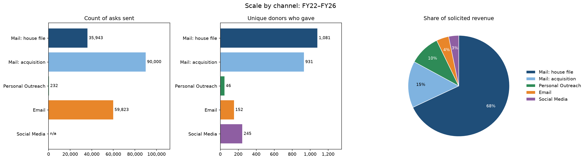

# Annual Giving Analytics: Channel ROI and a Give-Again Model

An end-to-end analytics project on five years (FY2022–FY2026) of annual giving data for a small nonprofit. It answers three questions every fundraising office faces:

1. **Which channels and donor segments are worth the money?**
2. **How do we turn first-time donors into repeat donors?**
3. **Which individual donors should get mail next year, and who should be reached by email only?**

This project revisits a channel performance report I developed with the Mass General Brigham technical team. In that role, I relied on others for the technical work. Here I did all of it myself: building the dataset, analyzing it in SQL, and modeling it in Python.

> All data is simulated. No real donor information is used.

---

## The project in three parts

| Part | What it covers | Notebook | Details |
|---|---|---|---|
| 1. Data | A synthetic donor database calibrated to published fundraising benchmarks | [`generate_data.py`](generate_data.py) | [Data README](readme_files/README_generatedata.md) |
| 2. SQL analysis | Channel ROI, segment performance, new donor retention | [`final_sql_exploration.ipynb`](final_sql_exploration.ipynb) | [Analysis README](readme_files/README_workbook.md) |
| 3. Give-again model | Predicting which donors will give next year, and choosing mail or email for each | [`next_gift_model.ipynb`](next_gift_model.ipynb) | [Model README](readme_files/README_model.md) |

---

## Highlights

**From the SQL analysis**

- **Existing donors carry the program.** Appeals to people already in the database raised 68% of solicited revenue.
- **Direct mail raises the most, and acquisition is what makes it look expensive.** Mail to the house file (people already in the database) cost $0.19–$0.22 to raise $1, while the acquisition mailing cost $0.98–$1.17, roughly breaking even in its first year.
- **The second gift is the turning point.** Only 19% of new donors gave again by the end of the following year, but every acquisition cohort from FY22–FY25 has already covered its mailing cost, mostly through second and later gifts.



**From the give-again model**

- **A cost-based mailing decision.** A gradient boosting model estimates each donor's chance of giving, and a donor gets mail only when their expected gift is worth more than the cost of mailing them. Everyone else stays on the email list.
- **Fewer mailings, nearly the same revenue.** The model mails 44% of the donor file and still reaches 88% of next year's givers. Compared with mailing every mailable donor, it mails 23% fewer people while keeping 99% of the gift revenue.
- **Contact information is a major lever.** 374 donors are worth mailing but have no usable address, and being mailable is the second strongest predictor of giving.

---

## The same work in business terms

| Fundraising term | Business equivalent |
|---|---|
| Cost to raise $1 | ROI by channel |
| House file vs. acquisition | Existing customers vs. paid acquisition |
| Second gift rate | Repeat purchase rate |
| Cohort payback | CAC payback period |
| Donor retention | Customer retention / churn |
| Will this donor give next year? | Repeat-purchase or churn model |
| Mail only when expected gift beats mail cost | Expected-value targeting across expensive and low-cost channels |

---

## Repository contents

```
├── README.md                     ← this file
├── requirements.txt              ← Python packages needed
├── generate_data.py              ← part 1: recreates the dataset exactly (fixed random seed)
├── final_sql_exploration.ipynb   ← part 2: SQL analysis notebook
├── next_gift_model.ipynb         ← part 3: model notebook
├── data/                         ← the seven data tables (CSV)
├── outputs/
│   └── fy2027_solicitation_scores.csv  ← model output: next year's mail and email plan
├── images/                       ← charts used in the READMEs
└── readme_files/
    ├── README_generatedata.md    ← how the data was built, data dictionary, assumptions
    ├── README_workbook.md        ← SQL analysis: findings and recommendations
    └── README_model.md           ← model: methods, results, and recommendations
```

## How to run it

1. Install the requirements:
   ```bash
   pip install -r requirements.txt
   ```
2. Optional: regenerate the dataset from scratch. The `data/` folder already includes the CSVs, so you can skip this step.
   ```bash
   python generate_data.py
   ```
3. Open the notebooks in Jupyter and run all cells, starting with the SQL analysis:
   ```bash
   jupyter notebook
   ```

## Tools

SQL (DuckDB, written to be MySQL-compatible), Python, pandas, NumPy, scikit-learn, Matplotlib, Jupyter

## Author

Laura Solarz, MS in Business Analytics candidate, Brandeis University
