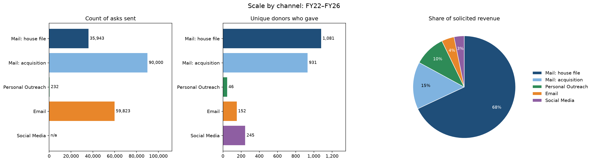
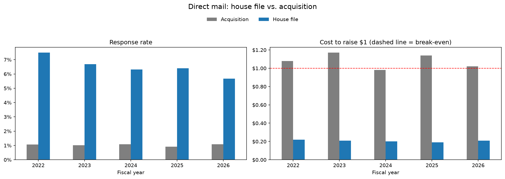
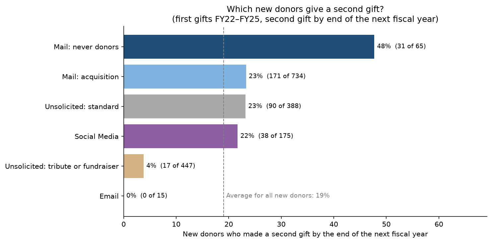
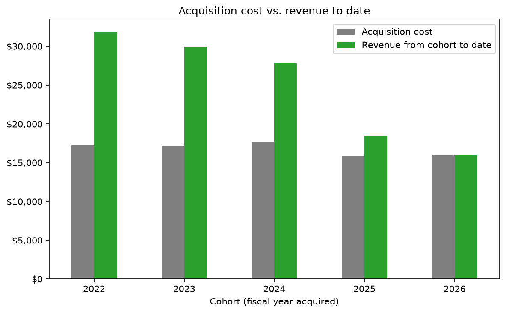

# Annual Giving Strategy: Segment Analysis, Channel ROI and New Donor Retention

SQL analysis of five years of annual giving data (FY22–FY26) to answer two questions every fundraising office faces: **which channels and donor segments are worth the money, and how do we turn first-time donors into repeat donors?**

This is part 2 of a three-part project. See the [main README](../README.md) for the full project, the [data README](README_generatedata.md) for how the dataset was built, and the [model README](README_model.md) for part 3.

This project revisits a channel performance report I developed with the Mass General Brigham technical team. In my past role, I relied on others for the technical work. Now I'm doing it myself, with a synthetic dataset I built and analyzed in SQL (DuckDB, MySQL-compatible syntax) and Python.

**[View the full analysis notebook →](../final_sql_exploration.ipynb)**

---

## The business question

A small nonprofit's annual giving program solicits donors through direct mail, email, social media, and personal outreach from fundraisers. Each channel has different costs, reach, and response. The analysis is organized in three parts:

1. **Who gives:** how solicitations, donors, and revenue split across channels, how large gifts are in each, and which mailing segments respond
2. **What each channel costs:** revenue and cost to raise $1 by channel, with direct mail split by year into the house file and the acquisition mailing, and each mail segment ranked by revenue per $1 spent
3. **New donors and the second gift:** where new donors come from, which ones give again, how long it takes, and whether acquisition mailings pay off over time

## Key findings

- **Current donors and the house file carry the program.** Appeals to people already in the database raised 68% of solicited revenue, and current donors responded to mail far more often than lapsed or never donors (10.5–16.6% per appeal vs. 2.9–4.1% and 0.7%).
- **Personal outreach works, as expected.** Just 46 top donors produced 10% of solicited revenue, with an average gift of $712. These were already the program's best donors, so the results reflect who is asked as much as how.
- **Direct mail raises the most, and acquisition is what makes it look expensive.** Over five years, direct mail returned $2.79 per $1 spent, less than the $4.82–$7.27 returned by email, social media, and personal outreach, but it raised far more than all of them combined. House file mail cost only $0.19–$0.22 to raise $1, while the acquisition mailing cost $0.98–$1.17, roughly breaking even in its first year.
- **New donors arrive through many doors.** About 445–465 new donors join each year, mostly through the acquisition mailing (164–197 a year) and unsolicited gifts (193–227 a year), many of them tribute or personal fundraiser gifts.
- **Most new donors never make a second gift.** Only 19% of new donors gave again by the end of the following fiscal year (24% excluding tribute and personal fundraiser donors, who return at only 4%). The Never Donors mailing brings in few new donors, but 48% of them give again, the highest of any group.
- **Second gifts come late.** Very few new donors give again within their first 12 months. For acquisition donors, only 2% had given again by 12 months, compared with 16% by 18 months, when the next year's fall and year-end appeals arrive.
- **The second gift is what makes acquisition pay off.** Every acquisition cohort from FY22–FY25 has already covered its mailing cost, mostly through second and later gifts.

### Recommendations

1. **Protect the house file.** Appeals to existing donors are the program's most efficient asks, so keeping donors giving matters more than any single appeal.
2. **Judge acquisition on long-term value, not first-year return.** The mailing roughly breaks even in year one and pays back through later gifts. The same logic applies to the Never Donors mailing, which loses money in the year it's sent but brings in the new donors most likely to give again.
3. **Close the first-year gap.** Most new donors hear little between their first gift and the next year's appeals. A stewardship plan (a prompt thank you, a welcome series, an impact update) and a test of an earlier, well-timed second ask target the point where most donors are lost.
4. **Use a lighter approach for tribute and personal fundraiser donors.** They rarely give again, so a low-cost touch makes more sense than the full renewal series.
5. **Keep personal outreach focused on top annual donors,** where the staff time pays off.

## The same analysis in business terms

The methods here apply directly to customer analytics outside fundraising:

| Fundraising term | Business equivalent |
|---|---|
| Cost to raise $1 | Cost per dollar of revenue / ROI by channel |
| House file vs. acquisition | Existing customers vs. paid acquisition |
| Cost per new donor | Customer acquisition cost (CAC) |
| Second gift rate | Repeat purchase rate |
| Time to second gift | Time to second purchase |
| Cohort payback | CAC payback period |
| Donor retention | Customer retention / churn |
| Mailing segments (recency and gift amount) | Recency and monetary value (RM) segmentation, as in RFM |
| Revenue to date by cohort | Customer lifetime value (to date) |

## About the data

Real donor data is confidential and can't be shared publicly, so this project uses a **synthetic dataset I built** to mirror a small nonprofit's annual giving program: about 10,700 constituents, 96,000 solicitations, 5,200 gifts, and 80 appeals over five fiscal years.

**What was set vs. what was measured.** The generator sets basic donor behaviors and costs as inputs: how likely each type of donor is to respond to an appeal, how gift sizes change over time, what each mailing costs, and how contact information goes out of date. These are based on published benchmarks and on my experience in development operations. The results analyzed here, including ROI, retention, cohort payback, and segment profitability, are not set anywhere; they come out of the simulation.

**How it compares to published benchmarks:**

| Metric | This dataset | Published benchmark | Source |
|---|---|---|---|
| Donor retention, overall | 40.4% | 43.3% | [1] |
| Donor retention, new donors | 18.8% | 18.9% | [1] |
| Donor retention, repeat donors | 59.8% | 59.3% | [1] |
| Direct mail response, existing donors | 9.3% | 5%–9% (house lists, all industries) | [2] |
| Cost to raise $1, mailings to existing donors | $0.15 | $0.20–$0.25 | [3], [4] |
| Cost to raise $1, acquisition mailing | $1.07 | $1.00–$1.50 | [3], [4] |
| Email response rate | 0.28% | 0.05% | [5] |
| Email revenue per 1,000 fundraising emails | $348 | $54 | [5] |
| Retention, memorial and tribute donors | 3.8% | Single digits | [6] |

Retention and direct mail results land close to their benchmarks. The direct mail benchmarks cover mail to current and lapsed donors only, while the house file figures in the key findings also include the mailing to never donors, so the house file's response rate is a bit lower and its cost to raise $1 a bit higher. Email results run well above M+R's on purpose: M+R reports averages across participating nonprofits and notes that they don't reflect many programs, especially those that segment their audiences. This dataset represents a smaller organization with a more engaged email list.

**Limitations.** Because it's generated, the data is cleaner and more predictable than a real CRM export: there are no duplicates or data-entry errors, donors follow set rules rather than reacting to outside events, and each gift is credited to a single appeal. Some patterns are shaped directly by those rules. For example, the 12–18 month wait before most second gifts comes from how the simulation sets donor status once a year. The specific numbers shouldn't be read as findings about real donors, but the queries, validation checks, and analysis approach apply directly to real data.

Full details on how the data was built and every assumption are in the [data README](README_generatedata.md).

### Sources

1. **Fundraising Effectiveness Project (FEP), *Q4 2025 Report*.** A collaborative project of the Association of Fundraising Professionals (AFP) Foundation for Philanthropy and GivingTuesday, released April 2026. Source for overall, new donor, and repeat donor retention. [AFP announcement, with a link to the full report](https://afpglobal.org/news/fundraising-effectiveness-project-reports-strongest-revenue-growth-five-years-even-fewer)
2. **Association of National Advertisers (ANA), *2024 Response Rate Report*.** House list direct mail response rates of 5%–9%, across all industries. Cited from a summary of the report: [Printing Impressions, "Revisiting Response Rates: Why Direct Mail's ROI Keeps Rising"](https://www.piworld.com/post/revisiting-response-rates-why-direct-mails-roi-keeps-rising)
3. **James Greenfield, *Fund-Raising: Evaluating and Managing the Fund Development Process* (1999).** The origin of the widely used cost-to-raise-a-dollar standards: about $1.00–$1.25 per dollar raised for direct mail acquisition and about $0.20 for direct mail renewal. Cited from a summary of the book: [NonProfit PRO, "Is Cost to Raise a Dollar an Important Metric?"](https://www.nonprofitpro.com/is-cost-to-raise-a-dollar-an-important-metric/)
4. **James Greenfield, "Reasonable Cost Guidelines for Solicitation Activities."** A separate version of Greenfield's guidelines, giving $1.25–$1.50 per dollar raised for direct mail acquisition and $0.20–$0.25 for direct mail renewal. The document credits the Direct Mail Marketing Association as the source of its direct mail figures. [PDF via OneOC](https://oneoc.org/wp-content/uploads/2019/10/fundraising-reasonable-costs-jim-greenfield.pdf)
5. **M+R, *M+R Benchmarks 2026*, "Email Messaging."** Fundraising email response rate (0.05%) and revenue per 1,000 fundraising emails sent ($54), for 2025. [mrbenchmarks.com/email-messaging](https://mrbenchmarks.com/email-messaging/)
6. **Bloomerang, "Memorial and Tribute Donors Can Be Retained (With Some Help)."** Retention of memorial and tribute donors, typically in the single digits. [bloomerang.com](https://bloomerang.com/blog/memorial-and-tribute-donors-can-be-retained-with-some-help)

## Skills demonstrated

- **SQL:** CTEs, multi-table joins, window functions (`ROW_NUMBER`, `RANK`, `SUM() OVER`), conditional aggregation, date arithmetic, and cohort analysis, written in standard SQL compatible with MySQL 8.0+
- **Data validation:** row count, data type, and missing value checks, and confirming gift dates line up with fiscal years
- **Python:** pandas for reshaping query results; matplotlib for bar charts, stacked bar charts, line charts, a heatmap, and a pie chart
- **Data generation:** a Python simulation calibrated to published fundraising benchmarks
- **Business communication:** translating results into recommendations for a fundraising team

## Repository contents and how to run it

See [Repository contents](../README.md#repository-contents) and [How to run it](../README.md#how-to-run-it) in the main README.

## Next steps

This analysis shows which groups of donors are more likely to give again, but not which individual donors. Part 3 of this project is a **machine learning model that predicts each donor's likelihood of giving in the following year**. It focuses mail on the donors whose expected gift is worth the cost of mailing them, and reaches everyone else through lower-cost email. **[See the model README →](README_model.md)**

---
